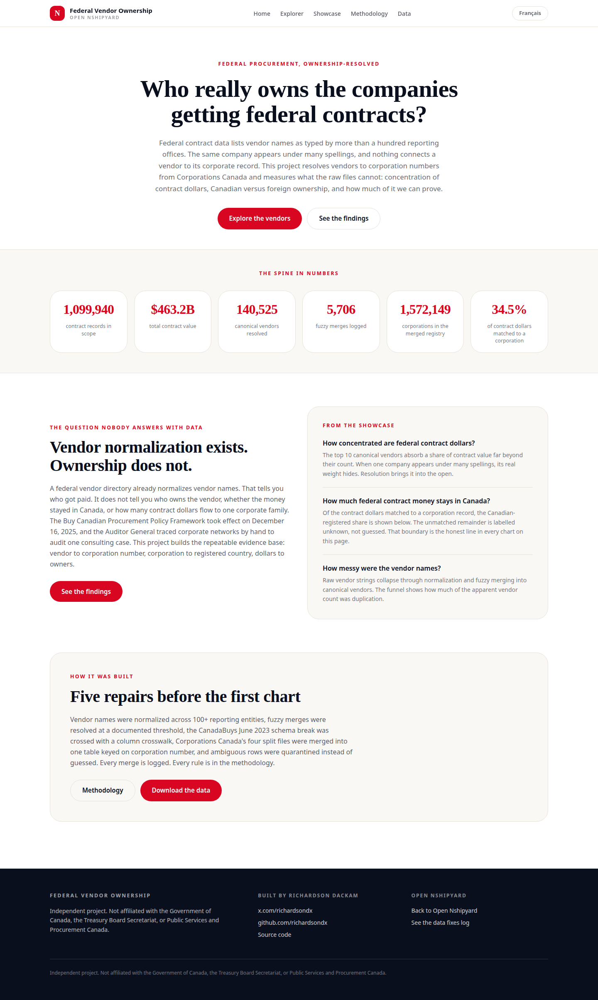
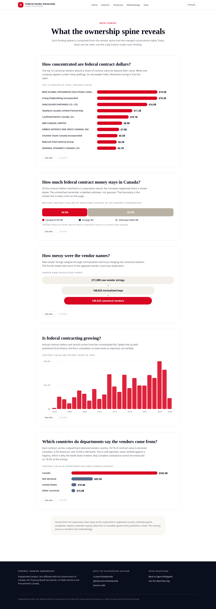
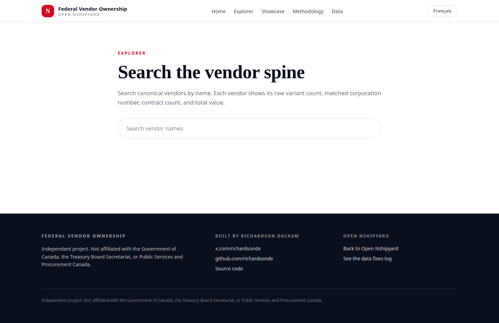
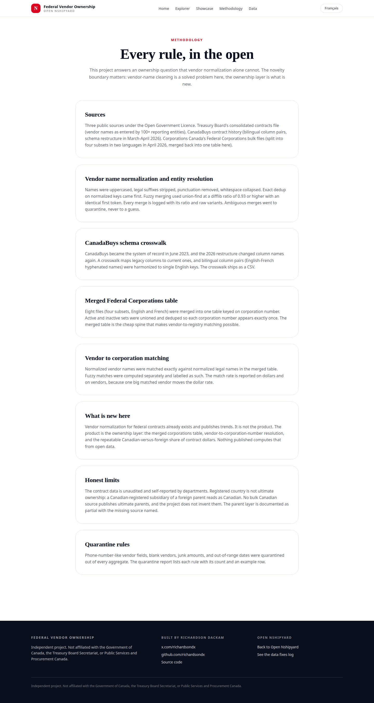
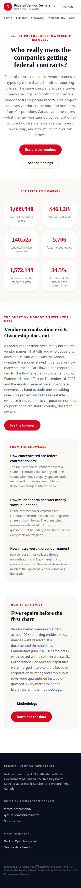
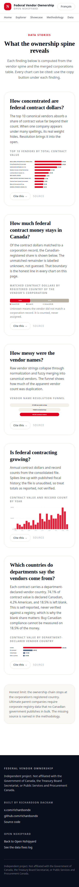

# Federal Vendor Ownership

Who really owns the companies getting federal contracts?

Federal contract data lists vendor names as typed by more than a hundred reporting offices. The same company appears under many spellings, and nothing connects a vendor to its corporate record. This project resolves vendors to corporation numbers from Corporations Canada and measures what the raw files cannot: concentration of contract dollars, the Canadian-versus-foreign share, and how much of it we can prove.

## Screenshots

| Home | Showcase |
| --- | --- |
|  |  |

| Explorer | Methodology |
| --- | --- |
|  |  |

Mobile:  

## What is new

Vendor normalization for federal contracts already exists and publishes trends. It is not the product. The product is the ownership layer: the merged Federal Corporations table (four subsets in two languages merged into one file keyed on corporation number), vendor-to-corporation-number resolution with every merge logged, and the repeatable Canadian-versus-foreign share of contract dollars.

## Honest limits

- The contract data is unaudited and self-reported by departments.
- Registered country is not ultimate ownership: a Canadian-registered subsidiary of a foreign parent reads as Canadian.
- No bulk Canadian source publishes ultimate parents, and this project does not invent them.
- Unmatched vendors are labelled unknown, never assigned a country.

## Data

All under the Open Government Licence - Canada. Sources: Treasury Board of Canada Secretariat "Proactive Publication - Contracts", Public Services and Procurement Canada "CanadaBuys contract history", Innovation, Science and Economic Development Canada "Federal Corporations".

- `data/corporations_merged.csv` - the merged corporations table (219 MB, excluded from git; regenerate with the pipeline, see `data/build_log.md`)
- `data/corporations.db` - SQLite index of the merged table for fast corp-number lookups (265 MB, excluded from git; built from the CSV)
- `data/vendor_spine.csv` - canonical vendors with corporation numbers, counts, values
- `data/vendor_merges.json` - every fuzzy merge with ratio and raw variants
- `data/canadabuys_crosswalk.csv` - legacy to current column mapping
- `data/quarantine_report.csv` - quarantine rules, counts, examples
- `data/build_facts.json` - machine-readable fact sheet

## API

- `GET /api/v1/vendors?q=&limit=` - search canonical vendors
- `GET /api/v1/vendors/{id}` - one vendor
- `GET /api/v1/corporations/{num}` - one corporation from the merged table
- `GET /api/v1/concentration` - ownership concentration aggregates
- `GET /api/openapi.json` - OpenAPI 3.1 document

## MCP

Streamable HTTP MCP at `POST /mcp`. Tools: `vendor_lookup`, `ownership_chain`, `concentration`. See `SKILL.md` and the Data page's connect panel.

## Development

```bash
npm install
npm run dev
npm run build
npm run start
```

TypeScript strict. ESLint clean. Tailwind CSS 4.

## Author

Richardson Dackam - https://x.com/richardsondx - https://github.com/richardsondx

Independent project. Not affiliated with the Government of Canada, the Treasury Board Secretariat, or Public Services and Procurement Canada.
